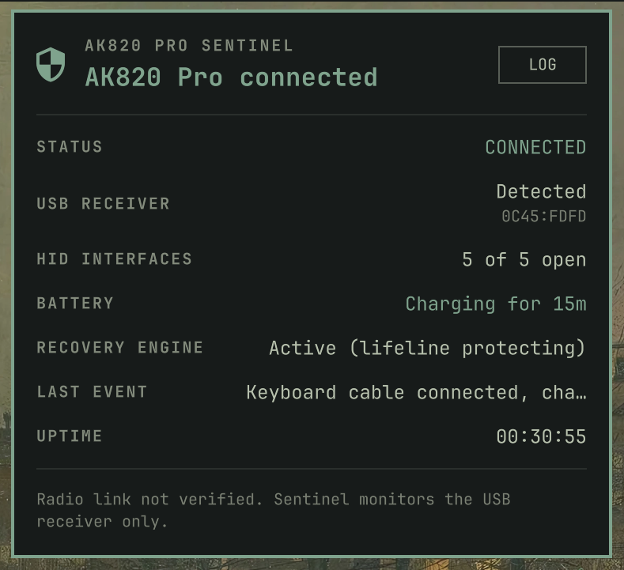

<h1 align="center">omarchy-ak820-pro-sentinel</h1>

<p align="center">
  <strong>Read-only HID watchdog and Omarchy bar widget for the Ajazz AK820 Pro.</strong><br>
  <em>Prevents random 2.4 GHz receiver disconnections on Linux and monitors battery charging state.</em>
</p>

<p align="center">
  <a href="https://github.com/imanubdesigner/omarchy-ak820-pro-sentinel/releases"></a>
  
  
</p>

<p align="center">
  
  
  <a href="LICENSE"></a>
</p>

<p align="center">
  <a href="#overview">Overview</a> •
  <a href="#features">Features</a> •
  <a href="#installation">Installation</a> •
  <a href="#using-the-widget">Using the Widget</a> •
  <a href="#event-log">Event Log</a> •
  <a href="#status-file">Status File</a> •
  <a href="#commands">Commands</a> •
  <a href="#how-it-works">How It Works</a> •
  <a href="#troubleshooting">Troubleshooting</a>
</p>

<p align="center">
  
</p>

---

## Overview

On Linux, the Ajazz AK820 Pro 2.4 GHz receiver (`0c45:fdfd`) can randomly stall or drop its RF link, requiring you to physically unplug and replug the USB dongle. 

This happens because the receiver exposes multi-endpoint vendor HID interfaces. While Windows actively opens and queries every interface, Linux does not submit Interrupt IN URBs on unhandled interfaces by default, causing the wireless controller inside the dongle to enter a low-power freeze.

**AK820 Pro Sentinel** resolves this issue completely and unobtrusively. It actively keeps a read handle open on the receiver's vendor interfaces (`hidraw3` and `hidraw4`) and continuously drains reports, ensuring the host USB controller keeps the link warm.

> [!IMPORTANT]
> **Proactive Prevention vs. Recovery**:
> Sentinel's primary job is proactive. By maintaining open descriptors on the vendor interfaces from boot, the RF link **never drops**. Under normal operation, Sentinel reports `PROTECTED (0 DROPS)` with `Recovery Engine: Active (lifeline protecting)`.

> [!NOTE]
> **Separation of Privileges**:
> Sentinel runs as a lightweight, low-footprint `systemd` service with read-only access to `/dev/hidraw*`. The Omarchy bar widget runs as your regular desktop user and reads only the world-readable `/run/ak820-pro-sentinel/status.json` snapshot. The GUI never runs as root.

---

## Features

- **Proactive RF Link Preservation**: Identifies multi-endpoint vendor interfaces (`hidraw3` and `hidraw4`) and keeps Interrupt IN polling active without sending any intrusive data.
- **Battery Charging Detection**: Detects when the keyboard is plugged in via USB cable (`0c45:8009 SONiX AK820`) alongside the 2.4G dongle, reporting live charging status (`Charging for <duration>`).
- **Native Omarchy Bar Widget**: Quickshell-powered status shield and popup panel matching active Omarchy theme colors live via `Commons.Color`.
- **Transparent Event Logging**: In-memory ring buffer tracking significant lifecycle events (dongle detection, lifeline openings, disconnects) with clear interface indicators (`IF 3`, `IF 4`).
- **Persistent Session Counters**: Disconnects and recoveries are saved across daemon restarts in `/var/lib/ak820-pro-sentinel/stats.json`.
- **Zero Kernel Hacks**: Pure read-only userspace watchdog. Never resets USB ports, never flashes firmware, and never modifies udev or autosuspend system files.
- **100% Automated Test Coverage**: Comprehensive suite with 76 Python unit tests and 6 Node.js model tests.

---

## Installation

### Prerequisites

- Arch Linux with [Omarchy](https://github.com/basecamp/omarchy) desktop environment.
- Python 3.10 or newer with `systemd`.
- Ajazz AK820 Pro wireless dongle (`0c45:fdfd`).

### 1. From the Omarchy Marketplace

Add the plugin using the standard Omarchy command:

```bash
omarchy plugin add https://github.com/imanubdesigner/omarchy-ak820-pro-sentinel.git --enable
```

Omarchy will prompt you for the bar section (**left**, **center**, or **right**; `right` is preselected).

When you first open the panel, it displays a setup card because root privileges are required to open HID device nodes:

```text
SERVICE NOT INSTALLED
The bar widget cannot keep the receiver awake on its own.

[ INSTALL IN A TERMINAL ]
```

Click **INSTALL IN A TERMINAL** to launch the installer in a floating terminal and enter your `sudo` password once. The widget will detect the active service within two seconds automatically.

> [!TIP]
> **One-Liner Install**:
> To enable the plugin and install the background service in a single command from your terminal:
> ```bash
> omarchy plugin add https://github.com/imanubdesigner/omarchy-ak820-pro-sentinel.git --enable \
>   && sudo ~/.config/omarchy/plugins/omarchy-ak820-pro-sentinel/install/install.sh
> ```

---

### 2. Manual / Full Install

Clone the repository and run the setup scripts:

```bash
git clone https://github.com/imanubdesigner/omarchy-ak820-pro-sentinel.git
cd omarchy-ak820-pro-sentinel

# Install widget and background systemd service
sudo ./install/install.sh
./install/omarchy-plugin.sh --no-backend
```

This installs:
- Backend daemon in `/opt/ak820-pro-sentinel/`
- Binary wrapper in `/usr/local/bin/ak820-pro-sentinel`
- Systemd unit `/etc/systemd/system/ak820-pro-sentinel.service`
- Config template in `/etc/ak820-pro-sentinel.conf`
- Omarchy widget in `~/.config/omarchy/plugins/omarchy-ak820-pro-sentinel/`

---

## Using the Widget

The bar displays a status shield:
- **Accent Color**: Healthy and actively protected (`AK820 Pro connected`).
- **Urgent Color**: Receiver unplugged, interface dropped, or daemon error.
- **Muted Color**: Service stopped cleanly.

Clicking the shield opens the status panel:

| Metric | Description |
| :--- | :--- |
| **STATUS** | Overall state (`CONNECTED`, `RECOVERING`, `DISCONNECTED`). |
| **USB RECEIVER** | Detection state and hardware ID (`0C45:FDFD`). |
| **HID INTERFACES** | Active descriptors held open (e.g. `5 of 5 open`). |
| **BATTERY** | Live charging status via USB cable (`Not charging` or `Charging for 15m`). |
| **RECOVERY ENGINE** | Watchdog state (`Active (lifeline protecting)` or retry backoff). |
| **LAST EVENT** | Most recent observed event message. |
| **UPTIME** | Elapsed duration of the current service session. |

---

## Event Log

Clicking **LOG** in the panel header toggles the event stream. 

At the top of the view, a fixed session banner provides real-time verification of the keepalive mechanism:

```text
5 HELD OPEN · UP 2h 34m · PROTECTED (0 DROPS)
```

The log records significant transitions with clear interface badges:
- `Lifeline interface opened [IF 3]` `/dev/hidraw3 (lifeline keepalive)`
- `Lifeline interface opened [IF 4]` `/dev/hidraw4 (lifeline keepalive)`
- `Interface opened [IF 0]` `/dev/hidraw0 (held open)`
- `Cable connected, charging` / `Cable removed`

> [!NOTE]
> Routine poll ticks are filtered out to keep the log clean and meaningful. Full technical traces are continuously streamed to `journalctl -u ak820-pro-sentinel.service`.

---

## Status File

The service maintains `/run/ak820-pro-sentinel/status.json` with mode `0644`:

```bash
ak820-pro-sentinel --status --json
```

Key schema fields:
- `receiver`: Present status, vendor/product ID, USB port bus path.
- `wired`: Cable connection state (`present`, `charging`, `since`).
- `summary`: `total`, `open`, `stable`, `lifeline_active`, `total_reports`.
- `interfaces`: Array of descriptors with endpoint count, lifeline flag, and report tallies.
- `session`: Counters for `recoveries`, `disconnects`, and `last_recovery_at`.

---

## Commands

```bash
ak820-pro-sentinel --check          # Validate config and scan sysfs interfaces once
ak820-pro-sentinel --status         # Human-readable status summary
ak820-pro-sentinel --status --json  # Raw status snapshot
ak820-pro-sentinel --diagnostics    # System, environment and sysfs diagnostic report
ak820-pro-sentinel --version        # Print version (1.1.0)
```

---

## How It Works

### What Sentinel Does
1. Scans `/sys/class/hidraw` for `0c45:fdfd` and identifies multi-endpoint vendor interfaces.
2. Opens `/dev/hidraw*` read-only (`O_NONBLOCK | O_CLOEXEC`).
3. Drains incoming reports with `select()` so the Linux USB subsystem continuously submits Interrupt IN URBs.
4. If a descriptor is severed, it attempts progressive reopening with a 1, 2, 4, 8, 15, and 30-second backoff.
5. Emits structured state snapshots to `/run/ak820-pro-sentinel/status.json`.

### What Sentinel Never Does
- Never writes data or output reports to the keyboard.
- Never sends firmware or configuration modifications.
- Never resets or power-cycles the USB bus.
- Never changes system-wide udev or power-management rules.

---

## Troubleshooting

### Monitor service logs in real time
```bash
journalctl -u ak820-pro-sentinel.service -f
```

### The widget shows NO DATA
Verify that the service is running:
```bash
systemctl status ak820-pro-sentinel.service
```
If stopped, start it with `sudo systemctl start ak820-pro-sentinel.service`.

### Moving between USB ports
Sentinel identifies devices by physical USB bus paths (`1-2.2:1.3`). When plugging the receiver into a different port, Sentinel automatically cleans up stale handles and establishes new connections within 3 seconds.

---

## Uninstallation

```bash
# 1. Remove widget from Omarchy
omarchy plugin remove omarchy-ak820-pro-sentinel

# 2. Remove backend service and system files
sudo ak820-pro-sentinel-remove
```

---

## License & Credits

Distributed under the **MIT License**. See [LICENSE](LICENSE) for details.

Based on the original reverse-engineering work from `microdia-fix` by Artem K. See [NOTICE.md](NOTICE.md) for legal notices and upstream acknowledgments.
